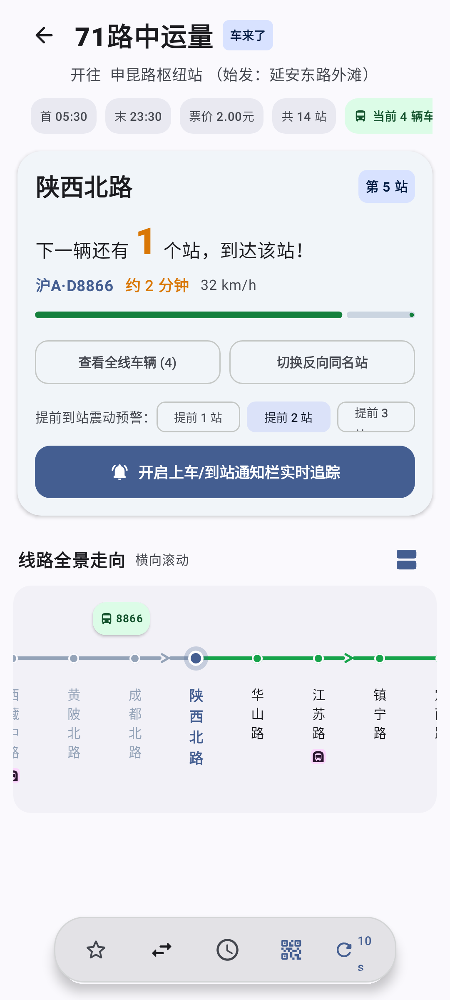
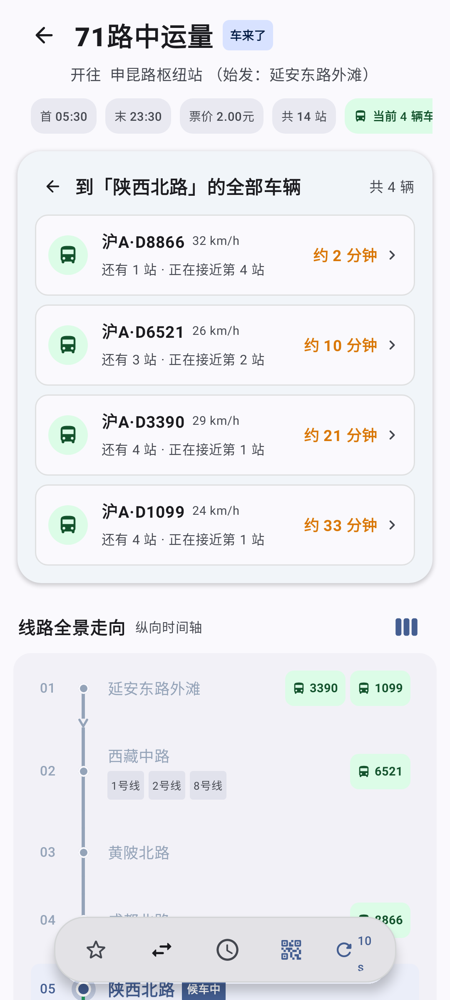
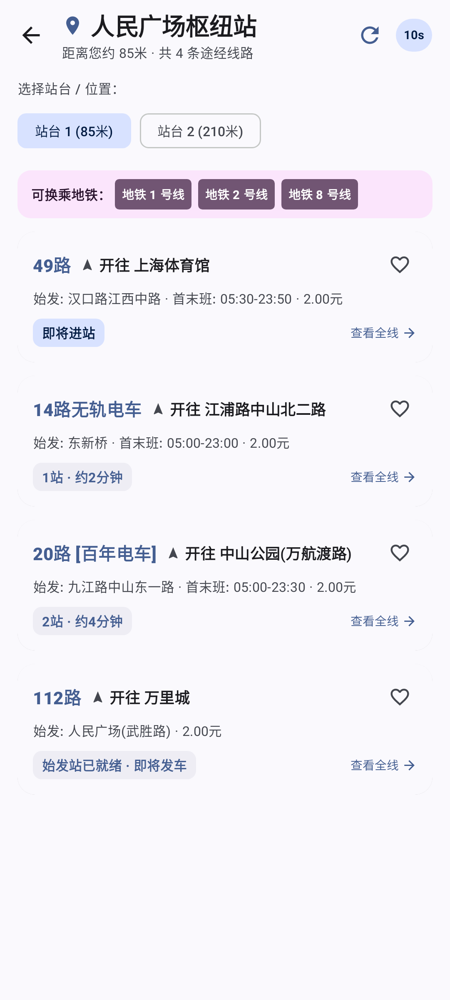
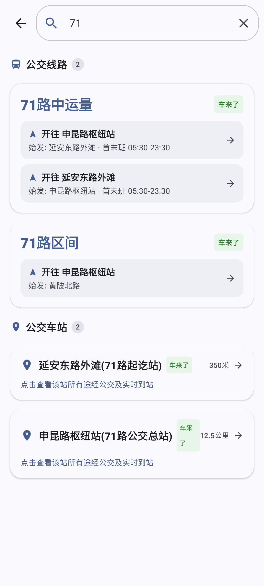
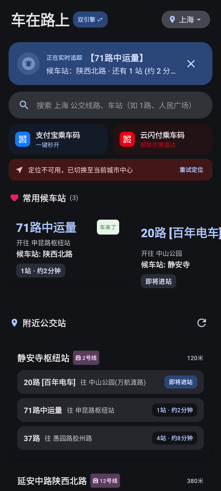
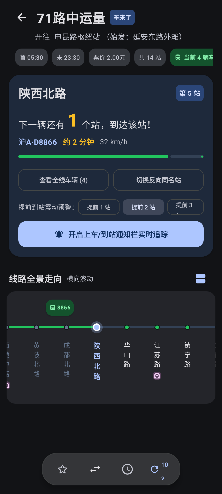

<div align="center">


# 追客 · Trackr

<p align="center">
  <strong>Android 实时公交到站追踪</strong>
</p>

<p align="center">
  <a href="https://github.com/5151561/Trackr/releases/latest">
    
  </a>
  <a href="https://developer.android.com">
    
  </a>
  <a href="https://kotlinlang.org">
    
  </a>
  <a href="https://www.jetbrains.com/compose-multiplatform/">
    
  </a>
  <a href="LICENSE">
    
  </a>
</p>

</div>

---

## 📸 界面预览

| 公交首页 | 线路详情 | 在途车辆 | 站点详情 |
| :---: | :---: | :---: | :---: |
| <br/>公交首页 | <br/>线路详情 | <br/>在途车辆 | <br/>站点详情 |
| <br/>搜索 | <br/>我的 | <br/>深色首页 | <br/>深色线路 |

> 全部 11 张截图（含「关于」页和深色版本）见 [截图物料库](screenshots/index.html)。截图由 Robolectric 在 JVM 上按 412 × 915 dp 渲染，不依赖真机。

---

## 📖 项目简介

追客（Trackr / BusOnRoad）是一款 Android 实时公交到站追踪应用。它把「下一班还有几分钟」放在第一屏，围绕公交、线路、站点和换乘路线组织信息，没有开屏广告，也没有信息流。

应用基于 **Material Design 3 Expressive** 设计，采用 **MAD 分层架构 + Kotlin Multiplatform**：业务页面、状态和大部分 UI 在 `commonMain`，Android 平台能力经接口注入。数据来自车来了与掌上公交两个实时数据源，按城市自动选择可用通道。

---

## ✨ 功能

### 公交首页

- **追踪卡片**：正在追踪的线路显示下一班倒计时、剩余站数和「结束」入口，切换页面不丢状态。
- **收藏**：按上车站展示每条收藏线路的到站时间；支持排序、分组和编辑。
- **附近站点**：按距离列出周边站点，直接展开多条线路的到站信息。
- **乘车码**：悬浮按钮一键打开，跟随底部页签收起 / 展开移动。
- **城市切换**：首页标题点开城市列表，切换城市后收藏按城市分开显示。

### 线路与站点

- **线路详情**：竖向时间轴走向条，标出每个站的站序、途经车辆和当前候车站；支持换向、时刻表、收藏和开始追踪。
- **一起等多条线路**：在站点详情里勾选任意条线路一起等，等车阶段只发一次站点请求；车到站后可以确认「上了哪辆」。
- **到站前提醒**：按时间创建定时提醒，到点自动开始追踪，快到站时发通知。
- **站点详情**：多物理站台切换、地铁换乘标签、途经线路综合到站看板。

### 路线规划

- 输入起点和终点，用高德公交算路给出换乘方案，按「最快 / 少换乘 / 少走路」标注。
- 地图上画出每段步行与公交折线；没有地图 Key 时只显示方案卡片，不影响算路。
- 方案可存成一条收藏路线，也可以直接开始追踪其中一程。

### 搜索与其他

- **搜索**：拼音、汉字模糊匹配，线路按方向一行显示「始发 → 终点」，区分主线和区间车。
- **通知与桌面**：常驻进度通知、到站提醒通知、Glance 桌面微件；小米设备额外适配焦点通知。
- **长辈版**：单列大字号界面，三档字号（1.0 / 1.5 / 2.0 倍），按钮不小于 64 dp。
- **深色模式**：跟随系统，地图同步切换夜间样式。

---

## 🏗️ 工程结构

```text
:androidApp          Android 壳：Activity、追踪服务、通知、桌面微件、定位、高德 Key 存储
:composeApp          根 Composable：主题、3 个页签、NavDisplay、Koin 模块装配
:core:designsystem   设计系统：颜色、字体、图标、通用文案
:core:model          领域模型（纯 Kotlin）
:core:domain         领域逻辑：到站规则、追踪状态机、坐标换算
:core:network        Ktor 客户端、车来了 / 掌上公交 / 高德 Web 接口
:core:data           仓库实现、追踪会话、收藏合并、高德 Key 两槽
:core:database       Room（trackr.db）
:core:datastore      DataStore：设置、高德 Key、追踪会话
:core:navigation     Navigation 3 的页面键与返回栈
:core:ui             多个 feature 共用的组件（乘车码、到站样式、轮询协调）
:core:testing        各仓库的 Fake，供单元测试与截图测试使用
:feature:bus         公交首页
:feature:search      搜索
:feature:stop        站点详情、一起等
:feature:line        线路详情、时刻表
:feature:route       路线规划、路线详情、高德地图
:feature:favorites   收藏编辑与分组排序
:feature:me          我的、定时提醒、高德 Key、关于
```

约定：

- UI 走单向数据流：`ViewModel` 暴露 `StateFlow<UiState>`，页面是无状态的 `Screen(state, onEvent)`。
- 功能模块只依赖 `:core:*`，模块之间不互相依赖；跨模块组件下沉到 `:core:ui`。
- Android 专有能力（定位、签名、乘车码、焦点通知、地图 SDK）放在 `androidMain`，`commonMain` 只依赖接口。
- 不同功能的改动分开提交，提交信息沿用 `type(scope): 描述`。

---

## 🛠️ 技术栈

| 模块 | 方案 |
| :--- | :--- |
| 语言 | Kotlin 2.4、Coroutines、Flow |
| UI | Jetpack Compose、Compose Multiplatform 1.12、Material 3 Expressive |
| 导航 | AndroidX Navigation 3（类型安全页面键、每个页签独立返回栈） |
| 依赖注入 | Koin 4.2 |
| 网络 | Ktor 3.6（Android 用 OkHttp 引擎）、Kotlinx Serialization |
| 本地存储 | Room 2.8（SQLite）、DataStore Preferences |
| 桌面微件 | Glance 1.2、WorkManager |
| 地图与算路 | 高德 3dmap + location + search（仅 Android） |
| 构建 | Gradle 9.8、AGP 9.5、Version Catalogs、约定插件 |
| 性能 | Baseline Profile、Macrobenchmark、Compose 稳定性配置 |
| 测试 | JUnit 4、Robolectric、Turbine、Ktor MockEngine、Jacoco |

---

## 🚀 构建与运行

### 环境要求

- JDK 21
- Android Studio 最新稳定版（需支持 AGP 9.5）
- Android 8.0（API 26）及以上设备
- `compileSdk 37` / `targetSdk 36` / `minSdk 26`

### 常用命令

```bash
# 全量单元测试（验收标准，不需要真机）
./gradlew test

# 只跑某个模块 / 某个测试类
./gradlew :feature:bus:testAndroidHostTest --tests "com.trackr.feature.bus.home.BusHomeViewModelTest"

# 编译并安装 Debug
./gradlew :androidApp:assembleDebug
./gradlew :androidApp:installDebug

# 覆盖率报告
./gradlew jacocoTestReport
```

### 发布 Release

```bash
./gradlew :androidApp:assembleRelease
```

按 ABI 出两个包，不合并成一个大包（高德 SDK 的原生库只支持 arm）：

| 产物 | 大小 |
| :--- | :--- |
| `androidApp/build/outputs/apk/release/androidApp-arm64-v8a-release.apk` | 约 47 MB |
| `androidApp/build/outputs/apk/release/androidApp-armeabi-v7a-release.apk` | 约 36 MB |

传到 GitHub Release 时按 `trackr-<版本>-arm64-v8a.apk` / `trackr-<版本>-armeabi-v7a.apk` 命名，应用会按设备架构下载对应包。

### 重新生成 README 截图

```bash
./gradlew :androidApp:testDebugUnitTest --tests "com.trackr.ui.ScreenshotGeneratorTest"
```

产物在 `androidApp/build/screenshots/promo/`，复制到 `screenshots/` 即可。截图测试用 Robolectric 的 native graphics，不启动模拟器。

---

## 🔑 高德 SDK 用法

路线规划页的地图和公交算路依赖高德。这一节说明**项目里怎么用**，以及**自己构建时怎么配 Key**。

### 用到了哪些能力

| 能力 | 实现 | 使用哪个 Key |
| :--- | :--- | :--- |
| 平面地图渲染：方案折线、起终点标记、定位蓝点、夜间样式 | `TextureMapView` + `AMap` | Android 平台 Key |
| 地点输入提示（起点 / 终点联想） | `Inputtips`（search SDK） | Android 平台 Key |
| 公交算路（换乘方案、步行段、票价） | `RouteSearch`（search SDK） | Android 平台 Key |
| 算路兜底 | `restapi.amap.com` 的公交路径规划接口 | Web 服务 Key |
| 定位 | 系统 `LocationManager`（不用高德定位取点） | 不需要 |

依赖只有一个一体化包，地图、定位、搜索都在里面：

```kotlin
amap-search = { group = "com.amap.api", name = "3dmap-location-search", version = "11.3.100_loc11.3.101_sea9.8.1" }
```

它只在 `:feature:route` 的 `androidMain`（以及 `:androidApp` 的构建配置）出现，`commonMain` 和其他模块不引用高德类。选 `11.2.100` 以上是因为从这个版本起 `.so` 按 16 KB 页对齐；低于它的版本在 16 KB 页大小的新设备上会加载失败。

### 两类 Key 严格分开

高德的「Android 平台 Key」和「Web 服务 Key」互不通用，填反是地图空白最常见的原因。

| Key 类型 | 用途 | 是否绑定包名 |
| :--- | :--- | :--- |
| Android 平台 Key | 地图渲染、输入提示、公交算路 SDK | 是，绑定包名 + 签名 SHA-1 |
| Web 服务 Key | `restapi.amap.com` 算路兜底 | 否 |

代码里两个槽位分别存储，互不回落（`AmapKeyRepository`）。生效优先级相同：

```text
App 内「我的 → 高德 Key」填的  >  local.properties / 环境变量注入的  >  空
```

两个槽都没有时，底栏不显示「路线」页签；只有 Web 服务 Key 时页签显示，能算路但不画地图；只有 Android Key 时地图和算路都可用。

### 配置 Key

**方式一：应用内填写（推荐给使用者）**

打开「我的 → 高德 Key」，分别填 Android 平台 Key 和 Web 服务 Key，保存后立即生效，不需要重新编译。首次使用会先弹高德隐私说明，同意后才初始化 SDK。

**方式二：构建时注入（推荐给自建打包）**

在 `local.properties`（已被 Git 忽略）里写：

```properties
# Android 平台 Key，绑定包名 + SHA-1
AMAP_ANDROID_KEY=你的 Android 平台 Key
# Web 服务 Key，只用于算路兜底，可选
AMAP_WEB_KEY=你的 Web 服务 Key
```

也可以用同名环境变量。构建时注入的 Android Key 会同时写进 `BuildConfig.AMAP_ANDROID_KEY` 和 Manifest 的 `com.amap.api.v2.apikey` 元数据。查看注入状态：

```bash
./gradlew amapKeyStatus
```

输出会列出两个 Key 是否已配置、最终包名，以及「一个 Key 可同时填发布版和调试版 SHA-1」的提示。

**注册 Key 时填什么**

- 包名：`com.github.u5151561.trackr`（debug 和 release 相同）。
- SHA-1：在路线规划页点「诊断信息」可以直接复制当前安装包的包名和签名 SHA-1。开源分发的 APK 签名固定，所有人用同一组包名 + SHA-1；自己从源码编译的人签名不同，需要按自己构建的 SHA-1 另注册一个 Key。

### 初始化顺序

顺序错了地图会一直黑屏或空白，所以代码里固定成这条链：

1. `TrackrApp` 启动时把 `BuildConfig` 里的 Key 交给 `MapSdkInitializer`。
2. 用户同意隐私说明后，`MapsInitializer.updatePrivacyShow/updatePrivacyAgree`、`ServiceSettings`、`AMapLocationClient` 一起完成合规声明。
3. `MapsInitializer.setApiKey`、`ServiceSettings.setApiKey`、`AMapLocationClient.setApiKey` 注入同一个 Android Key。
4. 之后才允许创建 `TextureMapView`；`AmapMapSession` 会等容器挂到窗口并完成一帧布局后再 `onCreate`。
5. 运行期换 Key 会销毁并重建地图实例，因为 SDK 只在创建时读一次 Key。

### 地图实例的生命周期

路线页挂在 Navigation 3 的 entry 上，切走页签时 composable 会被销毁。如果地图跟着销毁，每次切回来都要重新初始化 GL、重新拉瓦片，相机位置也会丢。

`AmapMapSession` 用一个 Activity 级的容器托管 `TextureMapView`：

- 切走页签：只把容器从窗口摘下（`onPause`），地图实例、瓦片缓存、相机位置保留；
- 切回来：同一个实例重新挂上（`onResume`）；
- 按 Home 或锁屏：暂停定位与渲染，回前台再恢复；
- Activity 真正销毁时才 `onDestroy`。

取景和坐标：

- 业务层统一存 WGS-84；交给高德前转成 GCJ-02（`CoordTransform`），否则会偏 300～600 米。
- 有方案时取景包住所有方案点，并为底部面板留出内边距；只有一个点或所有点重合时用 16 级街道缩放。
- 没有定位时用当前城市中心兜底，城市中心同样先转 GCJ-02。

### 算路与兜底

`AndroidAmapRouteGateway` 的规则：

1. 先走 Android 搜索 SDK 的公交算路；成功就直接返回。
2. 只有 SDK **调用失败**（未配 Key、网络、鉴权）才回落到 Web 服务接口。
3. SDK 成功但结果为空时不再请求 Web，避免重复打接口。
4. 算路结果按「城市 + 坐标 + 15 分钟时间桶」缓存，输入提示按「城市 + 关键字」缓存。
5. 所有高德调用都要求用户已同意隐私说明。

降级行为：

| 情况 | 界面表现 |
| :--- | :--- |
| 两个 Key 都没有 | 底栏不显示「路线」页签，其他功能不受影响 |
| 只有 Web 服务 Key | 路线页可算路，不显示地图区域 |
| Android Key 无效 / 未绑定当前签名 | 地图区显示失败原因和「重试」，算路仍可回落 Web |
| 15 秒内底图没画出来 | 浮层提示检查包名、SHA-1，或是否把 Web Key 当成了地图 Key |
| 设备是 x86 / x86_64 模拟器 | 原生库缺失，地图不可用；请用真机或 arm 模拟器 |

### 常见问题

- **地图一片空白**：先点「诊断信息」核对包名、SHA-1、Key 来源；再确认填的是 Android 平台 Key，不是 Web 服务 Key。
- **算路提示额度不足**：Web 服务 Key 的个人开发者配额较低（约 3 QPS），把应用内配置换成自己的 Key。
- **自己编译后地图不出图**：debug 签名和发布签名不同，需要把当前构建的 SHA-1 也加进同一个 Key，或单独注册。
- **16 KB 页设备上地图加载失败**：确认依赖是 `11.2.100` 及以上。

---

## iOS 开发

已提供复用现有 CMP 页面的 Xcode 宿主，打开 `iosApp/Trackr.xcodeproj` 的 Trackr scheme 即可构建。模拟器运行、存储说明和当前能力范围见 [iOS 启动工程](docs/ios.md)。

---

## ⚠️ 免责声明

项目仅用于学习与技术交流。实时公交数据来自第三方公开接口，请遵守数据提供方的服务条款，不要用于商业用途或高频抓取。

---

## 🤝 致谢

本项目在数据协议与接口分析中参考了以下开源项目：

- [yulin-bus-activity](https://github.com/misakano7545/yulin-bus-activity)：双平台 API 参考。
- [chelaile-mcp](https://github.com/PeanutSplash/chelaile-mcp)：车来了数据协议与参数参考。
- [BusFleetTracker-GuiYang-Public-Transit](https://github.com/mage802/BusFleetTracker-GuiYang-Public-Transit)：贵阳公交数据分析与追踪实现参考。

地图与公交算路由 [高德开放平台](https://lbs.amap.com/) 提供。

---

## 📄 许可证

本项目采用 [MIT License](LICENSE)。

---

## 🌐 友情链接

- [LINUX DO](https://linux.do/) —— 真诚分享、友好讨论的技术社区，本项目的交流与反馈也发布于此。
