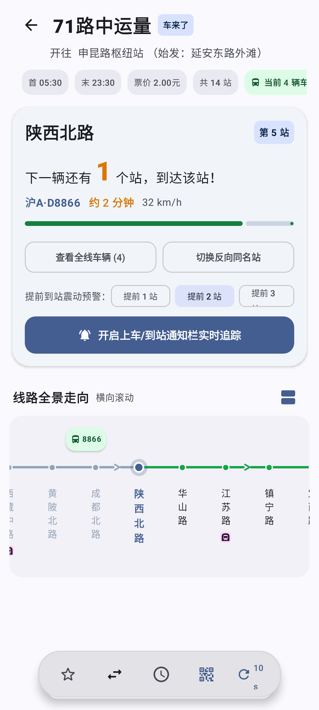
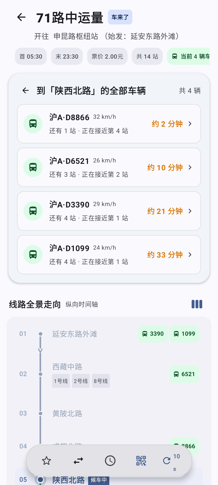
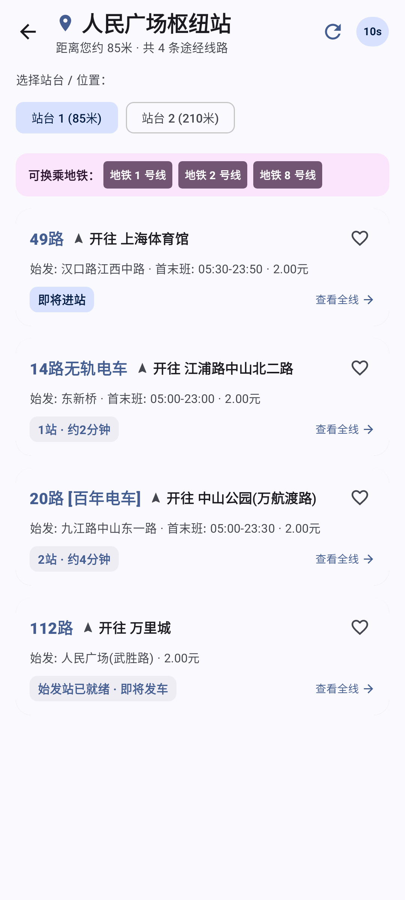

<div align="center">


# Trackr · BusOnRoad

<p align="center">
  <strong>Android 现代实时公交到站追踪应用</strong>
</p>

<p align="center">
  <a href="https://github.com/5151561/Trackr-/releases">
    
  </a>
  <a href="https://developer.android.com">
    
  </a>
  <a href="https://kotlinlang.org">
    
  </a>
  <a href="https://developer.android.com/jetpack/compose">
    
  </a>
  <a href="LICENSE">
    
  </a>
  
</p>

</div>

---

## 📸 界面预览

| 首页通勤看板 | 线路实时走向 | 车队在途雷达 | 换乘枢纽看板 |
| :---: | :---: | :---: | :---: |
|  |  |  |  |

> 💡 更多界面（包括深色夜间模式、纵向时间轴走向、极速搜索等）请查看 [完整截图物料库](screenshots/index.html)。

---

## 📖 项目简介

Trackr (BusOnRoad) 是一款专为通勤族打造的 Android 实时公交追踪应用。基于 **Material Design 3 Expressive** 设计规范与现代 Android 响应式架构构建，提供精准的车辆站序、到站倒计时、沿途车速与停靠区间展示，让日常公交候车更从容。

---

## ✨ 功能特性

- **🚌 实时追踪与到站预报**：精确展示目标线路上在途车辆的相对站序、预计到达时间与实时距离。
- **🗺️ 双模式线路走向图**：基于 Jetpack Compose 构建，支持横向平滑全景轨道与纵向时间轴两种视图无缝切换，适配不同读图习惯。
- **📡 车队雷达看板**：全线在途车辆一目了然，支持按距当前站距离排序，直观掌握车牌、实时时速与准点状态。
- **🚏 多站台交通枢纽看板**：支持大型公交枢纽站多物理站台一键切换、地铁换乘指引与全线综合到站看板。
- **🔍 极速线路与站点搜索**：支持拼音字母及汉字模糊即时联想，快速定位目标线路与首末班方向。
- **📱 桌面微件与常驻通知**：支持桌面 Widget 一键查看关注线路到站，搭配系统状态栏常驻进度与到站提醒通知。
- **🌙 质感深色模式**：遵循 Material 3 动态色彩与深色调优规范，夜晚候车舒适不刺眼。

---

## 🛠️ 技术栈

| 模块 | 方案 | 徽标 |
| :--- | :--- | :--- |
| 编程语言 | Kotlin (Coroutines & StateFlow) |  |
| UI 架构 | Jetpack Compose, Material 3 Expressive |  |
| 导航组件 | AndroidX Navigation 3 |  |
| 网络层 | OkHttp 4, Kotlinx Serialization |  |
| 本地存储 | Jetpack DataStore Preferences |  |
| 构建系统 | Gradle Kotlin DSL, Version Catalogs |  |

---

## 🚀 构建与运行

### 环境要求

- Android Studio Ladybug (2024.2) 或更高版本
- JDK 21 (兼容 Java 17+)
- Android 8.0 (API 26) 及以上设备或模拟器

### 编译步骤

1. **克隆仓库**
   ```bash
   git clone https://github.com/5151561/Trackr-.git
   cd busonroad
   ```

2. **构建 Debug APK**
   ```bash
   ./gradlew assembleDebug
   ```

3. **安装到已连接设备**
   ```bash
   ./gradlew installDebug
   ```

### 🔑 关于路线规划与高德 Key 最佳实践

为保障开源项目安全合规，并规避商业地图平台对公共个人 Key 的严格 QPS 并发限流（高德个人开发者仅 3 QPS 并发），本项目全面采用**自备 Key 与配置解耦**规范：

- **开源安全**：严禁提交任何正式 Keystore 及其密码（已加入 `.gitignore`），源码中无任何硬编码 Key。
- **动态适配证书指纹**：用户无论使用发布包、克隆后 Debug 编译或使用个人签名，在 App 内打开路线规划并点击右上角设置，即可**一键复制当前环境运行的真实包名与 SHA-1 安全码**，前往[高德开放平台](https://console.amap.com/)添加 **Android 平台** Key。
- **配置注入方式（二选一）**：
  1. **界面配置**：在 App 内设置弹窗直接粘贴保存；
  2. **工程解耦**：在本地 `local.properties`（已被 Git 忽略）中添加 `AMAP_ANDROID_KEY=你的Key`，编译时自动注入。
- **免 Key 兜底**：未配置 Key 时，应用将自动启用内置的实时公交直达与站点匹配引擎。

---

## 🤝 致谢

本项目在数据协议与接口分析中参考了以下开源项目：

- [chelaile-mcp](https://github.com/PeanutSplash/chelaile-mcp)：车来了数据协议与参数参考。
- [BusFleetTracker-GuiYang-Public-Transit](https://github.com/mage802/BusFleetTracker-GuiYang-Public-Transit)：贵阳公交数据分析与追踪实现参考。

---

## 📄 许可证

本项目采用 [MIT License](LICENSE)。

---

## 🌐 友情链接

- [LINUX DO](https://linux.do/) —— 真诚分享、友好讨论的技术社区，本项目的交流与反馈也发布于此。
