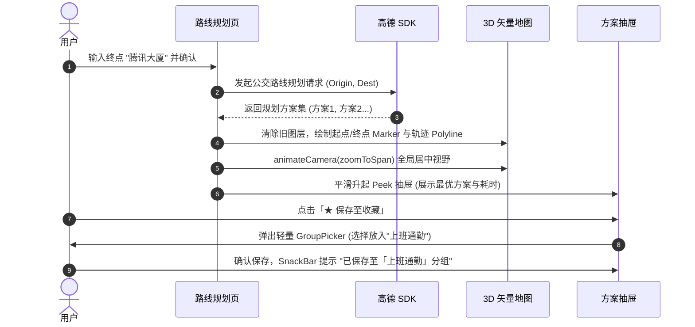
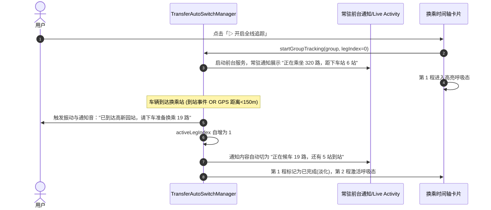

# BusOnRoad（追客）全套 UI 设计稿与交互规范说明书 (UI Spec v1.0)

> **设计基准**：严格遵循 Google **Material 3 (M3) Expressive** 设计规范与 Jetpack Compose 现代化声明式组件生态。  
> **服务场景**：轻量级、秒开、低认知负荷、高信息密度的专业实时公交与换乘出行工具。

---

## 一、设计系统基础规范 (Design Tokens)

### 1. 调色盘与语义化色彩系统 (Color Roles)

| 语义角色 | Light Mode 颜色值 | Dark Mode 颜色值 | 用途与视觉心理 |
| :--- | :--- | :--- | :--- |
| **Primary (品牌主色)** | `#1976D2` (科技蓝) | `#90CAF9` (冰湖蓝) | 顶部激活态、主要行动按钮、公交路网高亮轨迹 |
| **Secondary (换乘与中转)** | `#7C4DFF` (紫罗兰) | `#B388FF` (浅紫) | 换乘站点标记、换乘行程段连接线、备选线路次要标签 |
| **Transit Active (即将到站)** | `#00897B` (松石绿) | `#4DB6AC` (荧光青) | 实时到站车辆（<3站/5分钟内）、正点运行指示、起点 Marker |
| **Transit Warning (拥堵/停运)** | `#E65100` (炽橙色) | `#FFB74D` (暖杏橙) | 线路首末班临界、大间隔发车、终点 Marker |
| **Walking Accent (步行)** | `#78909C` (蓝灰) | `#90A4AE` (浅蓝灰) | 换乘步行连线（虚线）、步行用时小标签 |
| **Surface (卡片背景)** | `#FFFFFF` | `#1E1F22` (深灰底) | 换乘时间轴卡片、顶部搜索浮层背景 |
| **Surface Variant (容器底)** | `#F0F4F8` (微冷灰) | `#2B2D31` | 悬浮抽屉拖拽栏、未激活行程段底色、次选车辆胶囊 |
| **Outline (微妙分割线)** | `#E0E3E7` (0.8dp) | `#3D4148` (0.8dp) | 卡片内部分割线、搜索框边框、时间轴竖向连接线 |

### 2. 空间、间距与圆角阶梯 (Shape & Spacing Hierarchy)

- **间距标尺**：`4dp` (微间隙) / `8dp` (内聚间距) / `12dp` (组内间距) / `16dp` (标准页面与卡片内边距) / `24dp` (分区块留白)。
- **圆角规范 (Expressive Shapes)**：
  - **Extra Small (`4dp`)**：状态 Badge、小站点标签。
  - **Small (`8dp`)**：输入框内嵌清除按钮、次选车辆胶囊。
  - **Medium (`16dp`)**：换乘时间轴卡片、方案概览卡片。
  - **Large (`24dp`)**：顶部悬浮搜索面板、底部方案抽屉（Top Corner）。
  - **Full (`Circle`)**：起点/终点 Marker、定位悬浮按钮、FilterChip。

---

## 二、全局顶级导航架构 (4-Tab Scaffold)

底部导航栏提供 4 个清晰的一级 Tab，支持在列表向下滑动时优雅下沉隐藏，向上拉动时平滑升起。

```
+-----------------------------------------------------------------------+
|                                                                       |
|                         [ 当前处于活跃状态的页面内容 ]                       |
|                                                                       |
+-----------------------------------------------------------------------+
|  [ 🚌 首页 ]        [ 🗺️ 路线规划 ]       [ ★ 收藏 ]       [ ⚙️ 更多 ]   |
|   (实时看板)           (矢量地图)           (分组管理)         (偏好设置)   |
+-----------------------------------------------------------------------+
```

* **首页 (Home)**：聚焦当前定位周边站点、常坐线路秒级到站看板。
* **路线规划 (Route Plan)**：全屏矢量地图 + 起终点 POI 检索 + 真实路网轨迹 + 方案抽屉。
* **收藏中心 (Favorites)**：包含分组切换体系（全部/通勤/回家），容纳单线路、站点与多段换乘组合。
* **更多 (More)**：多源切换（车来了/公交云/高德）、缓存清理、无障碍与关于。

---

## 三、界面 1：专属「路线规划」Tab (`RoutePlanScreen`) 深度设计

路线规划界面彻底告别粗糙弹窗，采用**全屏地图底座 + 顶部悬浮搜索岛 + 底部方案可拖拽抽屉**的主流出行架构。

### 1. 界面线框草图 (Screen Layout Wireframe)

```
+-----------------------------------------------------------------------+
|  [顶部悬浮搜索岛 - 24dp 圆角卡片，带微妙投影 (Elevation 6dp)]            |
|  +-----------------------------------------------------------------+  |
|  |  ○ [起点] 📍 我的位置 (可点选或搜索)                     [ ⇅ 互换 ] |  |
|  |  ─────────────────────────────────────────────────────────────  |  |
|  |  ● [终点] 🔍 输入目的地、商圈或公交地铁站             [ ✕ 清空 ] |  |
|  +-----------------------------------------------------------------+  |
|                                                                       |
|   [高德 3D 矢量地图层 (全屏铺满)]                                       |
|                                                                       |
|         🟢 起点 Marker                                                |
|            \                                                          |
|             \ ───── (虚线: 步行 80 米) ───── 🚏 碧海湾地铁站          |
|                                               \                       |
|                                                \ ════ (实线高亮轨迹)   |
|                                                       11号线          |
|                                                 \                     |
|                                                  🚏 前海湾中转站     |
|                                                  |                    |
|                                                  ════ 1号线轨迹       |
|                                                  |                    |
|   [ 🧭 罗盘/指北针 ]                             🔴 终点 Marker       |
|   [ 🎯 居中到定位点 ]                                                  |
|                                                                       |
|  +=================================================================+  |
|  |  [底部方案可拖拽抽屉 (Bottom Route Sheet) - 顶部 24dp 圆角]        |
|  |  ─────────── [ 抽屉拖拽条 Handle: 32dp x 4dp ] ───────────     |
|  |                                                                 |
|  |  [ 方案 1 (推荐) ] · 约 36 分钟 · 步行 280米 · 换乘 1 次 · ¥5.0   |
|  |  ┌───────────────────────────────────────────────────────────┐  |
|  |  | 11号线 (碧海湾 -> 前海湾) ➔ 1号线 (前海湾 -> 高新园)       |  |
|  |  | 首班 06:00 · 末班 23:45 · 综合拥挤度：舒适                 |  |
|  |  └───────────────────────────────────────────────────────────┘  |
|  |                                                                 |
|  |  [ ★ 保存至收藏分组 ]              [ ▷ 开启全线实时追踪 (推荐) ] |  |
|  |   (弹出轻量分组选择器)               (直接唤起后台服务并进入追踪模式)  |
|  +=================================================================+  |
+-----------------------------------------------------------------------+
```

### 2. 覆盖物与地图交互细节 (Map Elements Spec)
1. **起终点与换乘 Marker**：
   - **起点 (Origin)**：直径 `28dp` 绿色圆形 Badge，内置白色定位小圆点，下方浮动气泡展示“碧海湾站（起点）”。
   - **终点 (Destination)**：直径 `28dp` 红色圆形 Badge，内置白色终点旗帜图标，下方浮动气泡展示目的地名称。
   - **换乘中转站 (Transfer Stop)**：直径 `22dp` 紫色双环 Badge，标记中转站名称与换乘线路编号。
2. **轨迹折线 (Polyline Visuals)**：
   - **公交/地铁轨迹**：线宽 `6dp`，半透明边框抗锯齿，颜色取自主线路主题色（如 11 号线暗红、1 号线绿色，若无特指则采用 Primary `#1976D2`）。
   - **步行连接段**：线宽 `3dp`，蓝灰色 `#78909C`，点状虚线（`dashPattern = [10f, 10f]`），直观表达步行接驳。
3. **自适应镜头缩放**：
   - 规划成功后，调用高德地图 `animateCamera(CameraUpdateFactory.newLatLngBounds(bounds, 120))`，地图自动将起终点及全程轨迹完整平滑居中在视窗内。

### 3. 抽屉状态变化 (Drawer Expansion States)
- **Peek 状态 (高度约 160dp)**：
  - 仅展示当前选中的最优方案总览，以及底部的两个行动按钮（「保存至收藏」与「开启全线实时追踪」），最大程度为全屏地图留出视野。
- **Expanded 状态 (展开至 60% 屏幕高度)**：
  - 露出全部备选方案列表（方案 1：用时最短、方案 2：少换乘、方案 3：少步行）。
  - 支持展开查看完整沿途途经站列表（如“途经 6 站，展开查看详情”）。

---

## 四、界面 2：全新「收藏中心」Tab (`FavoritesScreen`) 设计

将原先突兀的“路线组”整合回归为**分组收藏体系**，为常坐线路与日常通勤提供统一入口。

### 1. 界面线框草图 (Screen Layout Wireframe)

```
+-----------------------------------------------------------------------+
|  收藏中心                                                 [ ⚙️ 管理分组 ] |
|  ───────────────────────────────────────────────────────────────────  |
|  [ 顶部智能分组滑动栏 (Filter Chips) ]                                  |
|  ( 全部 12 )  ( 上班通勤 2 )*  ( 回家 1 )  ( 周末休闲 0 )  [ + 新建分组 ] |
|  ───────────────────────────────────────────────────────────────────  |
|                                                                       |
|  [ 方案 / 线路卡片流 (LazyColumn) ]                                    |
|                                                                       |
|  ┌─ 多段换乘方案卡片 (Transfer Timeline Card) ──────────────────────┐  |
|  │ 晨间通勤 (家 -> 科技园) · 上班通勤分组          [ ▷ 开启全线追踪 ] │  |
|  │ 总预估用时: 38 分钟 · 换乘 1 次 · 步行 220 米                      │  |
|  │                                                                  │  |
|  │  ○ 起点: 碧海湾站                                                │  |
|  │  │                                                               │  |
|  │  ├─ [第 1 程] 320 路 (备选: M375)                                │  |
|  │  │   • 实时: 还有 2 站 · 约 4 分钟 (粤B12345)                    │  |
|  │  │                                                               │  |
|  │  ◎ 换乘: 高新园地铁站 (步行 120 米)                              │  |
|  │  │                                                               │  |
|  │  ├─ [第 2 程] 19 路 (备选: 204 路)                               │  |
|  │  │   • 实时: 还有 5 站 · 约 11 分钟                              │  |
|  │  │                                                               │  |
|  │  ● 终点: 腾讯大厦                                                │  |
|  └──────────────────────────────────────────────────────────────────┘  |
|                                                                       |
|  ┌─ 单线路实时卡片 ─────────────────────────────────────────────────┐  |
|  │ 324 路                                           [ 上班通勤分组 ] │  |
|  │ 候车站: 科技中一路 -> 终点: 南山中心区总站                        │  |
|  │ 实时: 还有 1 站 · 约 2 分钟 (车牌: 粤B88888)                      │  |
|  └──────────────────────────────────────────────────────────────────┘  |
|                                                                       |
+-----------------------------------------------------------------------+
```

### 2. 分组管理交互 (Group Management BottomSheet)
点击右上角「⚙️ 管理分组」唤起半屏弹窗：
- **操作项**：
  - 新建分组（输入分组名称，如“公司通勤”、“健身房”）。
  - 分组拖拽排序（长按拖动手柄调整排序）。
  - 重命名 / 删除分组（删除分组时提示：*“仅删除分组标签，组内收藏将归入未分组”*）。

---

## 五、核心组件深度设计：多段换乘时间轴卡片 (`TransferTimelineCard`)

作为整个通勤与换乘场景的灵魂组件，卡片必须在方寸之间清晰传递：**全程动线、当前换乘节点、各段实时到站、以及备选线路的优先级**。

### 1. 结构与间距图解

```
+-----------------------------------------------------------------------+
| [A. 卡片头部]                                                         |
| 方案标题: 晨间通勤 (家 -> 科技园)                     [ ▷ 开启追踪 ]   |
| 标签: [上班通勤] · 预估 38 分钟 · 换乘 1 次           [ ⋮ 更多选项 ]   |
| --------------------------------------------------------------------- |
| [B. 节点时间轴区域 (Timeline Zone)]                                   |
|                                                                       |
|  (○) 绿色起点圆点 (8dp)                                               |
|   │  文本: 碧海湾站 3号口                                             |
|   │                                                                   |
|   ├── [第一程公交容器 (Leg 1 Box) - 浅蓝高亮微底色]                     |
|   │    主线路: 320 路 (开往 科技园方向)               [ 2 站 · 4 分钟 ] |
|   │    备选线路胶囊: [ M375 路 · 5 站 ]                               |
|   │    下车提示: 乘 6 站，在「高新园地铁站」下车                      |
|   │                                                                   |
|  (◎) 紫色双环换乘圆点 (10dp)                                          |
|   │  步行指引: 步行 120 米至对向站台 (约 2 分钟)                      |
|   │                                                                   |
|   ├── [第二程公交容器 (Leg 2 Box) - 待乘默认底色]                      |
|   │    主线路: 19 路 (开往 蛇口港方向)                [ 5 站 · 11分钟 ] |
|   │    备选线路胶囊: [ 204 路 · 8 站 ]                                |
|   │    下车提示: 乘 4 站，在「腾讯大厦」下车                          |
|   │                                                                   |
|  (●) 红色终点圆点 (8dp)                                               |
|      文本: 腾讯大厦                                                   |
| --------------------------------------------------------------------- |
| [C. 卡片底部状态栏]                                                   |
| 状态标记: 🟢 第 1 程候车中 · 距离首选车辆 1.2 km       [ 点击查看轨迹 > ] |
+-----------------------------------------------------------------------+
```

### 2. 关键视觉特性规范
1. **多车智能聚合 (Multi-Bus Aggregation)**：
   - 当一段行程配置了多条可选公交（如 320 和 M375 均可）：
   - 系统并发获取两路车的实时 ETA。
   - **主展示位**始终呈现**最先到达的车辆**（绿色大字展示“2 站 · 4 分钟”）。
   - **副展示位**以 Small Chip 紧凑展示次选线路（灰色胶囊展示“M375 · 5 站”），点击胶囊可直接切换为主视线。
2. **段落状态呼吸感知 (Dynamic Pulse Effect)**：
   - **未开始状态**：所有段落均为默认微灰底色 `#F8F9FA`。
   - **正在候车/乘坐状态**：该段落边框施加 `1.5dp` 主色 Primary 边框，左侧时间轴圆点带有轻微呼吸光晕动效。
   - **已乘完段落**：整段透明度降为 `0.6`，主文本带浅灰划线或收起，减少视觉噪音。
3. **点击下钻 (Deep Drill-down)**：
   - 点击第 1 程卡片区域 -> 直接跳转至该线路的实时全景轨迹图（`LineDetailScreen`），目标站序自动定位到下车站。

---

## 六、交互状态与动效时序规范 (Transitions & States)

### 1. 路线规划与生成时序


### 2. 多段自动换乘追踪流转


---

## 七、设计审核与下一步确认

这份 UI 设计稿已覆盖：
1. **全局架构**：底栏 4-Tab（首页、路线规划、收藏、更多）。
2. **路线规划页**：全屏高德 3D 矢量地图 + 顶部搜索岛 + 覆盖物 + 底部自适应抽屉。
3. **收藏中心**：智能分组切换栏 + 卡片混合流 + 分组管理 Sheet。
4. **多段换乘卡片**：节点时间轴 + 多车智能聚合 + 动态呼吸态。

请审阅本设计稿！如果你对上述 UI 布局、信息排布、或动效流程有任何调整意见，请随时指出；若整体认可，我们将开始有条不紊地进行**代码清理与模块规范落地**！
